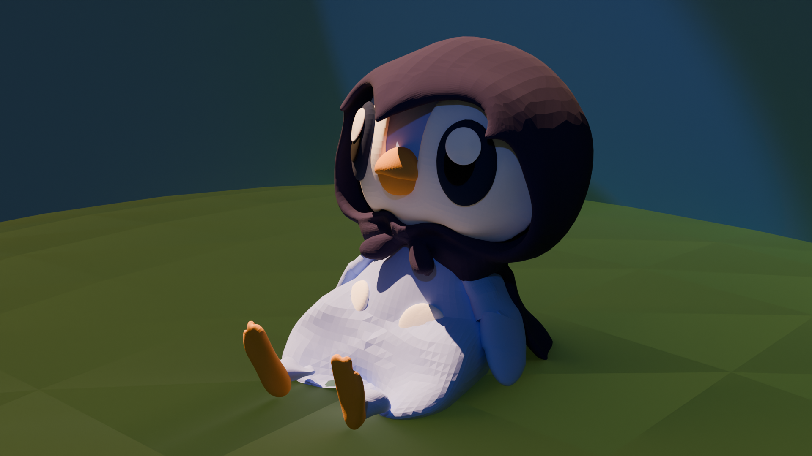

# Fall 2026 Projects
---

---
This website is used to display the projects made in the CART 253 class

## Useful(?) Links

1. [This Webpage](./README.md)
2. [Journal](./journal.md)

## Challenges

1. [Instruction Challenge](./instruction-challenge/index.html)
2. [Variables Challenge](./variables-challenge/index.html)
3. [Conditional Challenge](./conditionals-challenge/index.html)
4. [Events Challenge](./events-challenge/index.html)
5. [Function Challenge](./functions-challenge/index.html)

## Assignments

**Assignment 1** 
   - [Pip Plup](./Assignment1/Prototype_1/index.html)
   - [Circle](./Assignment1/Prototype_2/index.html)
   - [Random Rice](./Assignment1/Prototype_3/index.html)

**Assignment 2** 
   - [Bouncy](./Assignment2/Prototype1/index.html)
   - [Auto Pong](./Assignment2/Prototype2/index.html)
   - [I see you](./Assignment2/Prototype3/index.html)

**Assignment 3** 
- [Yo Yoyo](./Assignment3/Prototype1/index.html)
- [Power Pong](./Assignment3/Prototype2/index.html)
- [Canvas](./Assignment3/Prototype3/index.html)

**Assignment 4**
- [Rock Stacker](./Assignment4/Prototype1/index.html)  [Github](https://github.com/Jimmy-Le/CART253/tree/main/Assignment4/Prototype1)
- [Carnival](./Assignment4/Prototype2/index.html) [Github](https://github.com/Jimmy-Le/CART253/tree/main/Assignment4/Prototype2)
- [Insomnia](./Assignment4/Prototype3/index.html) [Github](https://github.com/Jimmy-Le/CART253/tree/main/Assignment4/Prototype3)

**Assignment 5**
- [Eating Coins](./Assignment5/Prototype1/index.html)  [Github](https://github.com/Jimmy-Le/CART253/tree/main/Assignment5/Prototype1)
- [Carnival](./Assignment5/Prototype2/index.html) [Github](https://github.com/Jimmy-Le/CART253/tree/main/Assignment5/Prototype2)
- [Insomnia](./Assignment5/Prototype3/index.html) [Github](https://github.com/Jimmy-Le/CART253/tree/main/Assignment5/Prototype3)