# Reflective Journal
---
## (New) 30 October 2026

I have read the feedback from the other assignments, and for this assignment I tried to keep that in mind while working on it.
- There should be a a good amount of commit messages
- The prototypes are a bit more diverse and creative (in my opinion at least)

For the first prototype, I wanted to make a little "board game" where the movement is intended to be on tiles and similarly to pac-man you run around eating a coin.
The main challenges is ensuring that the player and coin don't spawn out of bounds and are centered inside the tiles. 
So by using helper functions, I calculate the potential position of the player and return a boolean indicating if that new position is valid or not. This is also reused for the next coin position, as I want it to spawn on a tile that is adjacent to the player.

I then added in a text with the amount of coins to gamify it a bit more
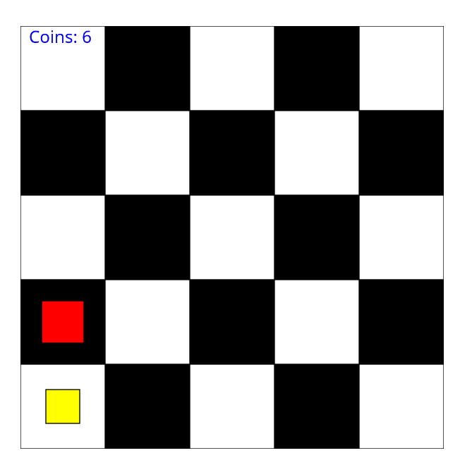

For the second prototype, It is a tree with falling leaves.
I thought the idea of making leaves fall slowly and sway left and right would be interesting to make.
I used functions in a way to not manually create multiple objects and incorporated the arrays from the lecture to be able to individually give each leaf its own movement. 
The shaking of the leaves was originally an accident, since i generally use the random function to randomly determine if an object should have a positive or negative movement, but forget that it returns a float value instead of an int. So this time i gave it a large range of values and it ended up giving me this erratic motion that is pretty good for falling leaves.
Using the modulo opperator, I can also easily cycle through the leaves again, which is kind of like the cycle of a tree.

For the third prototype, I wanted to use functions to rotate the positions of the circles when it is on play mode.
However, due to time constraints, I will instead give the illusion that it is spinning around by having colored circles circle around in a circle.
It isn't too complex, but i think it looks neat.

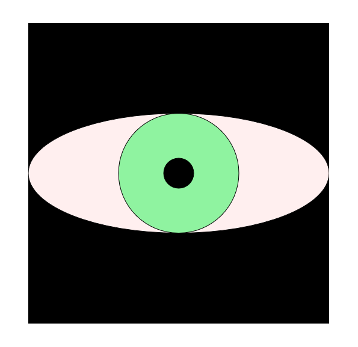
---

## 19 October 2026

Events are fun things to look into. I usually stuggle with this topic, but with the in-class challenge and p5js's version of them make it a lot more understandable.

Unfortunately, this past week I have been swamped with work from other classes and work :|
Thus, this week focuses more on using different types of events rather than being super creative and complex with it.

For Rock Stacker, I wanted to work with the drag and drop event. 
At first I only used the drag and drop, but that caused a weird bug where the rocks wouldn't follow the mouse cursor. Instead it would teleport and stop moving. After looking around, the solution was to incorporate a `mousePressed()` event to "select" the rock.

There is also a "bug" where the code is set up so that the rocks don't fall into each other by checking collisions. But, that made it so that when the rocks touch eachother midair, they both stop falling. I kept in the "feature" cause it was kinda fun to remove the rock underneath and stack it on top.

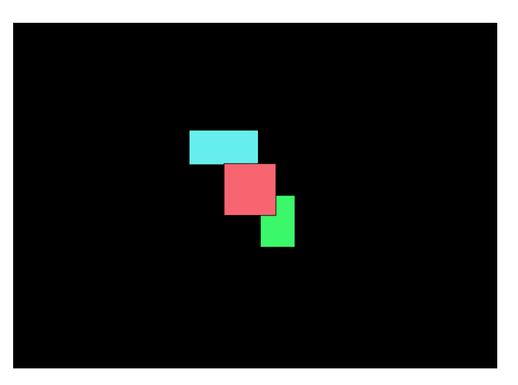

For Carnival, I wanted to use keyboard events.
The first thing that popped up in my head is that one hammer game with the bell. This also gave me the opportunity to experiment with using sound effects.
I tried using the p5.js's `loadSound()`, but it was causing me a bunch of errors. So i instead used the p5.js's DOM `createAudio` to handle it, and it worked perfectly.

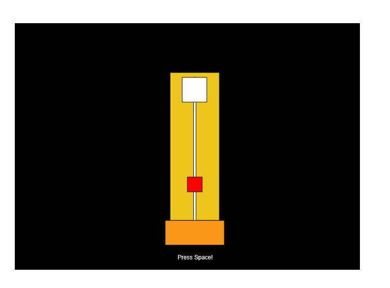

At the point of making Insomnia, I was bombarded with all the anouncements of the assignments due xd.
So I kept it simple and made it use a simple `mouseMoved()` event to wake up the eye. I then later include `mousePressed()` to include more mouse stuff.

---
## 05 October 2026

This is gonna be a reoccuring topic, but I also don't really know what to do for the "Conditional" prototyping, so I just kinda did random projects that has an if/else statement in it.

The first prototype is a Yoyo. I originally wanted to do a swinging stopwatch, but trying to apply a curve formula did not go well. Instead it was dragging on the floor for a bit and went up. I thought that was cool so I changed it a bit to become a Yoyo.

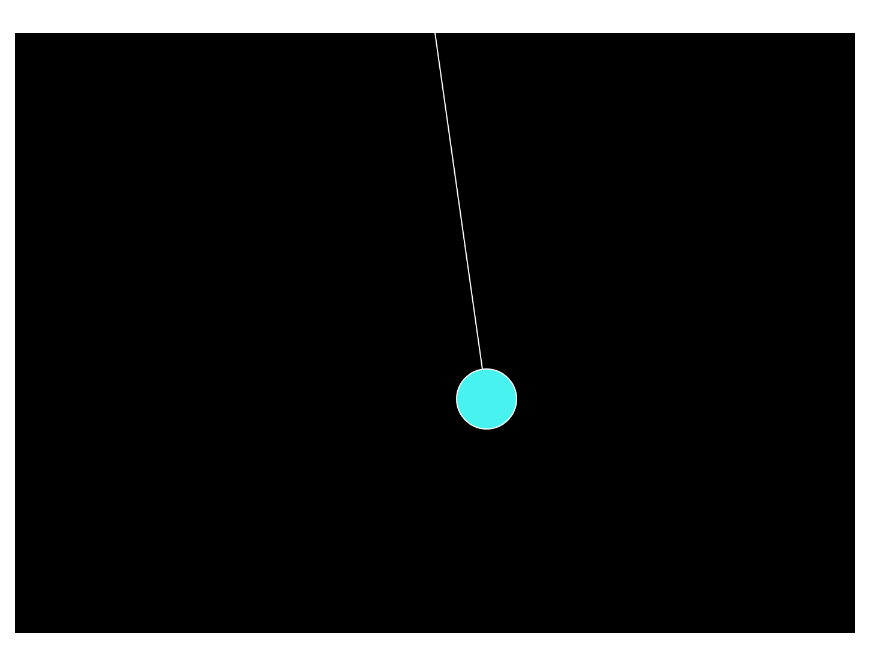

I copied over assignment 2 as a base template, so the Pong showed up and I was wondering if there were ways for me to improve it (instead of starting a project from scratch xd)

In this prototype, I fixed up some pesky bugs in the original version:
- Needed to use an If Else instead of 2 If blocks (????) to make the ball hit the left/right sides and reset
- Separated the left and right paddle code to only push the ball in the opposite direction (prevents a lot of self pingponging )

I also made the paddle follow the mouse and have the ball accelerate upon hitting a paddle. This makes it fun to swing around.

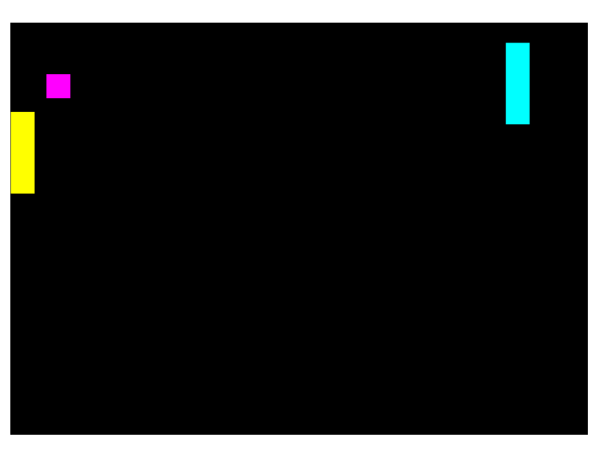

For prototype 3, I wanted to make it so you spawn a ball, and it falls and bounces off the floor at half the height each time. But when I first clicked on the canvas, a line of balls showed up, and I thought it would be fun to make a canvas instead.

(I will probably keep that first idea for next week)

To make the canvas more user-friendly, i added in a reset button and a erase/draw toggle button

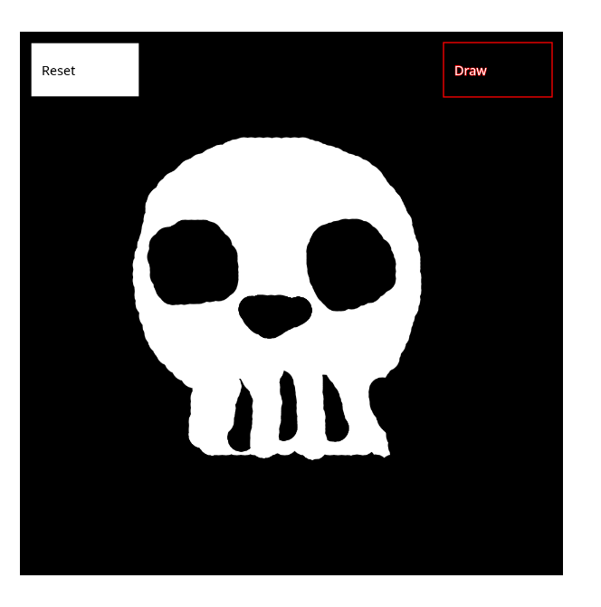

---
## 29 September 2026

I don't really know how to *do* the variable challenge, since I kind of live and breath variables as a programmer.
So I just made projects that uses variables for movement, updates and storing data.

Considering that I was kinda confused on what to do, my first prototype is simply the dvd logo screen saver that bounces off walls and changes color. I used variables to update its position as well as randomly assign a new RGB color.

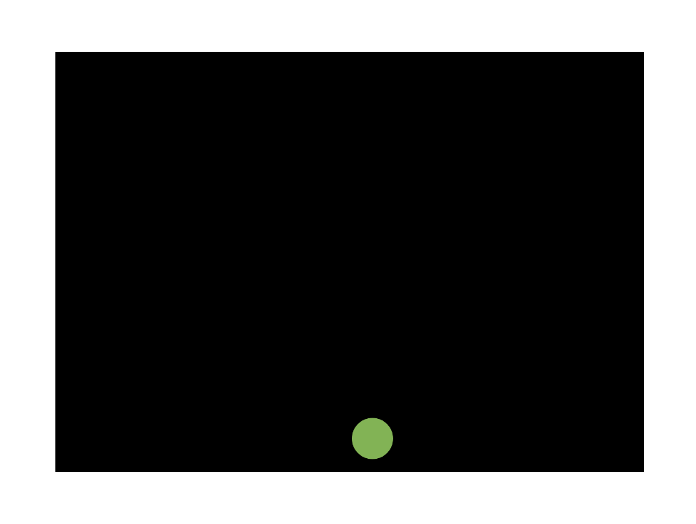

For the second prototype, I kind of followed the same route, but I thought that doing Pong would be a fun progression.
Since I didn't want to actually program the controlled movement, I made it "auto" play instead.
In theory, if the ball escapes and hits the left or right wall it would reset its position back to the middle, but there were some weird bugs where it just gets stuck on the sides and vibrate. I couldn't debug it without ripping out my hair, so I made the paddle and ball speed consistent with each other, so they would *in theory* never miss.

Same thing as the first prototype, I used variables to affect the movement of the ball and paddle.

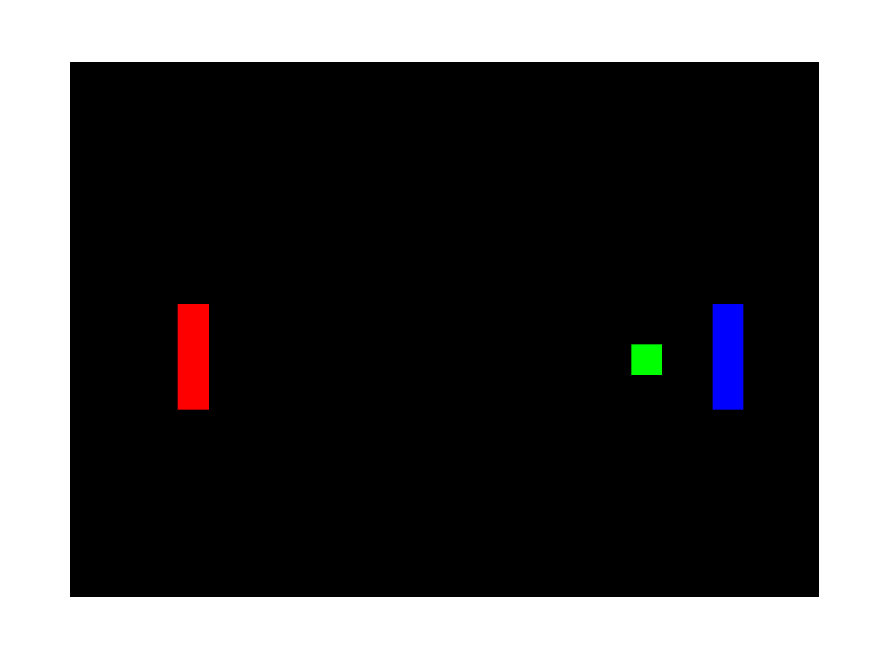

Finally for the third prototype, a game that I play (Honkai Star Rail) just released the animations for a new character which is heavily inspired by Alice in Wonderland. So I thought about doing a Cheshire Cat with its eyes. (Minus the teeths)

I used variables for the movement again and to store the positional data of each object on screen. 

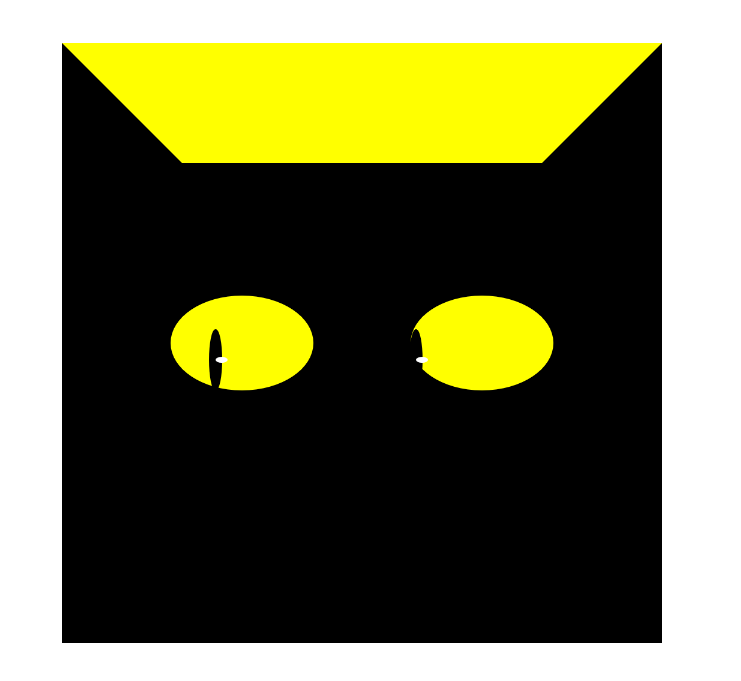

## 21 September 2026

As of doing the challenge and prototypes, I didn't know anything about P5js so I had to look around the Reference and read through the examples to figure out how to use them. What I learned, is that most of the shape functions are formatted as (x,y) coordinates for each corner of the shape, while others are useing a starting coordinate and then width and height.

For my first prototype, I wanted it to be a more detailed drawing, so I used the different shapes to form a decently accurate piplup. I did try out to use the vertex shapes for more accurate figures, but that was painfully slow to setup, especially when trying to fine-tune the placements. I also wanted to have curvy shapes, so I tried using the bezier shapes, but I gave up and opted to use overlapping circles instead.
Overall, I really liked the results, but man did it take long to get the positioning right

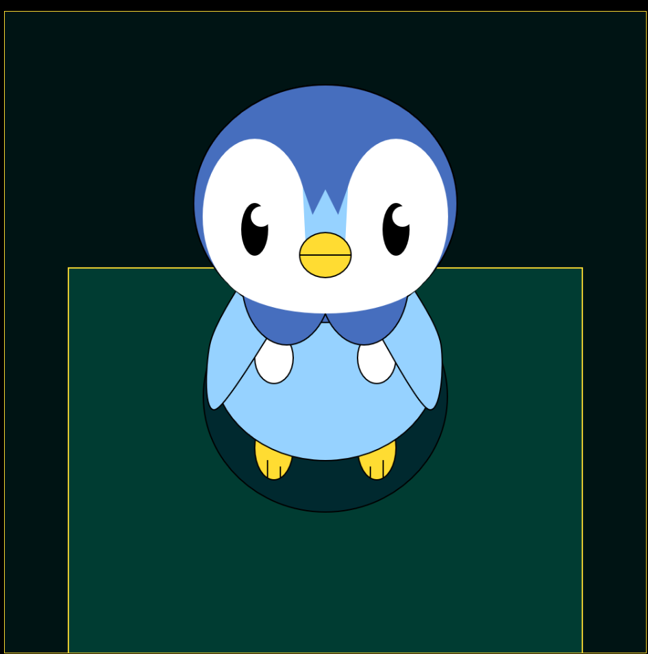

For prototype 2, I wanted to try to procedurally generate the shapes (mainly cause I was tired of calculating coordinates). I was originally thinking about generating the Canada flag through a pointilism artstyle, with the plan being that I have an array of coordinates where it would not draw points once it reaches that point. However, that didn't work for some reason, but it does work with the inverse of generating points on where I **don't** want it to be. So instead, I wanted it to maybe have some columns of different colored points and I ended up with this pattern by shifting the points coordinate index by 1. It makes white circles that aren't actually there which looked cool.

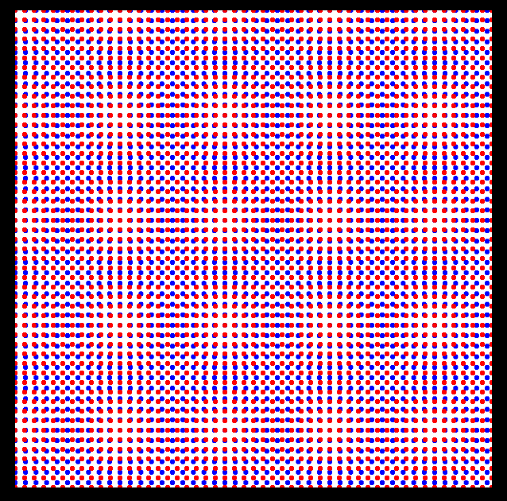

For Prototype 3, I wanted to try making something animated and randomized, so I made it draw shapes of random colors. I did have to wipe the screen because it would keep generating and eating up all the memory of my computer and crashing the browser. So I used the deltaTime provided by P5js to help make the time to delete and spawn drawings consistent. There wasn't really much else with this one. I was really tired at this point.

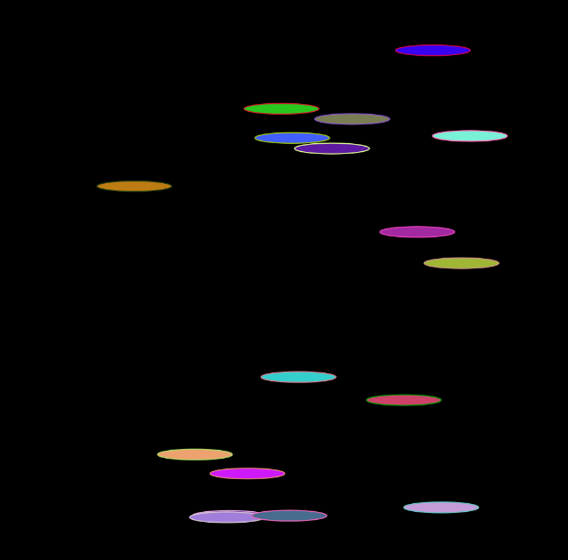

Also I struggle to commit my changes a lot of the time. I often commit when I am done with a session rather than a section as I ADHD my way through different part rather than focusing on one thing. For this course, I will try to be mindful, but like I will sometimes do things in batches.

---
## 8 September 2026

Imma be real, while I am more experienced with programming in general, I didn't know about GitHub Pages and how easy it was to set up. 
I also didn't know that markdown files could be used as a webpage. It definitely feels a lot easier to write than HTML / CSS, however, the styling could use some work. 
I will probably try to figure out a way to make it more colorful eventually. I will also probably use this to make a portfolio website once I figure out how to style it properly. If not, I can probably use HTML as a base instead.

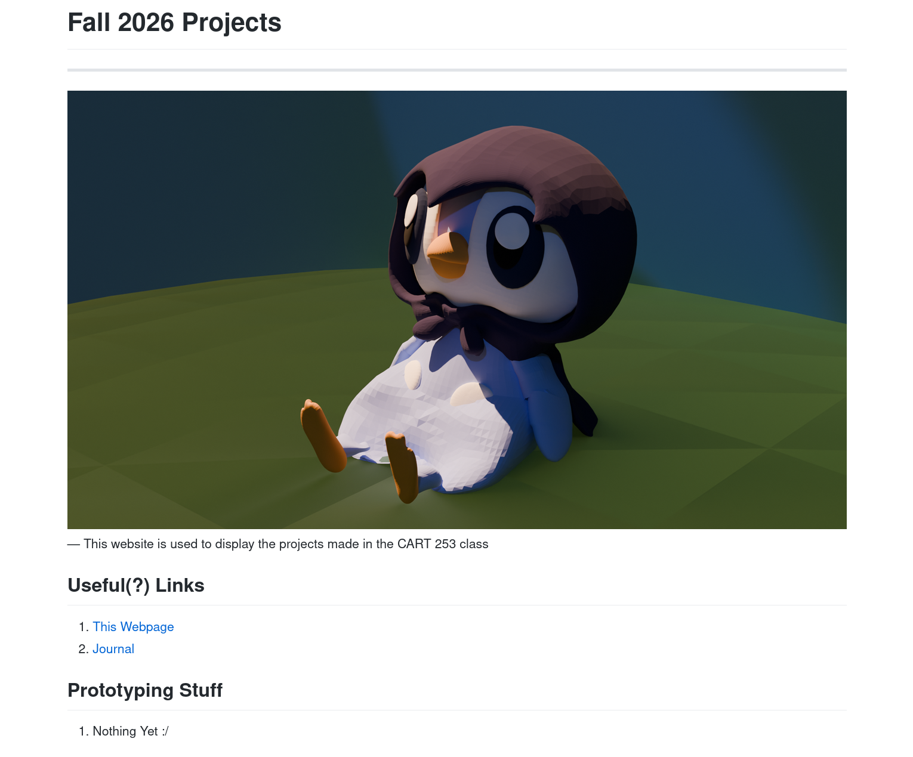
---
